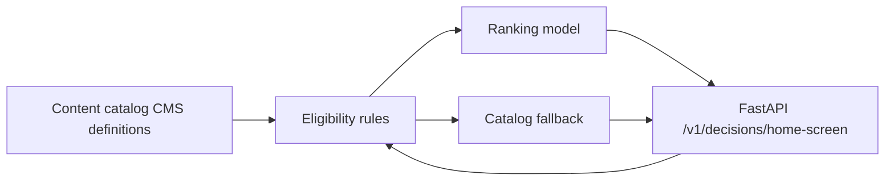

# Telecom home screen decision engine

Python service that personalizes three self-care home slots—**hero**, **notifications**, and **quick_links**—using eligibility gates first, then an explainable ranker with CMS-order fallback.

## Architecture



| Layer | Location | Responsibility |
|--------|----------|----------------|
| Content (CMS) | `decision_engine/content/catalog.py` | What can be shown: copy ids, LOB, slot, editorial priority, targeting metadata, rule hints |
| Eligibility | `decision_engine/eligibility/rules.py` | Hard filters before ranking (region, owned products, account status, tenure, data usage, AutoPay) |
| Ranking | `decision_engine/ranking/model.py` | Weighted linear score + reason codes; fallback sort by `catalog_sort_order` |
| Orchestration | `decision_engine/decision/service.py` | Per-slot pipeline, LOB quick-link caps, slot limits |
| API | `decision_engine/api/main.py` | HTTP contract for frontend/backend integration |
| Features | `decision_engine/schemas/features.py` | Offline dataset schema |
| Synthetic data | `data/synthetic/generator.py` | **SYNTHETIC ONLY** — no real customer data |

### Slots and limits

- **hero**: default 1 item
- **notifications**: default 3 items
- **quick_links**: up to 8, capped per LOB (`wireless`/`business` 8, `fiber` 6, `prepaid` 4)

### Ranking model (v1)

Weighted sum (documented weights in `ranking/model.py`):

- CMS `business_priority` (35%)
- Propensity map keyed by `propensity_key` (40%)
- App recency via `days_since_last_app_open` (15%)
- Segment targeting match (10%)

When there is no propensity map **and** no `days_since_last_app_open`, the engine uses **fallback** ordering by CMS `catalog_sort_order` with reason code `FALLBACK_LOB_DEFAULT`.

### Reason codes

| Code | Meaning |
|------|---------|
| `ELIGIBLE_BUSINESS_PRIORITY` | Primary driver was editorial priority |
| `ELIGIBLE_HIGH_PROPENSITY` | Primary driver was propensity |
| `ELIGIBLE_RECENT_ENGAGEMENT` | Primary driver was recent app use |
| `ELIGIBLE_SEGMENT_MATCH` | Primary driver was segment targeting |
| `FALLBACK_CATALOG_ORDER` | Pure CMS order (internal fallback helper) |
| `FALLBACK_LOB_DEFAULT` | Insufficient behavioral data; LOB catalog order |
| `INELIGIBLE_FILTERED` | Reserved for analytics when items are dropped pre-rank |

## API contract

> **Note:** `frontend/docs/api-contract.md` is not present on `main` yet. This document is the source of truth for the decision engine until frontend/backend publish a shared contract.

### `GET /health`

```json
{ "status": "ok" }
```

### `POST /v1/decisions/home-screen`

**Request**

```json
{
  "customer": {
    "customer_id": "string",
    "line_of_business": "wireless | fiber | prepaid | business",
    "segment": "consumer | premium | senior | student | smb",
    "account_status": "active | past_due | suspended | pending",
    "region_code": "US-TX",
    "locale": "en-US",
    "active_product_skus": ["SKU_5G_UNLIMITED"],
    "tenure_days": 100,
    "has_autopay": false,
    "data_usage_pct": 0.8,
    "days_since_last_app_open": 2
  },
  "slot_limits": {
    "hero": 1,
    "notifications": 3,
    "quick_links": 8
  }
}
```

`slot_limits` is optional; LOB caps still apply to `quick_links`.

**Response** `200`

```json
{
  "customer_id": "string",
  "line_of_business": "wireless",
  "model_version": "ranking-v1",
  "eligibility_passed_count": {
    "hero": 2,
    "notifications": 3,
    "quick_links": 8
  },
  "decisions": [
    {
      "slot": "hero",
      "items": [
        {
          "content_id": "hero_wless_5g_upgrade",
          "slot": "hero",
          "rank": 1,
          "score": 0.7425,
          "reason_code": "ELIGIBLE_HIGH_PROPENSITY",
          "reason_detail": "High propensity for offer"
        }
      ]
    }
  ]
}
```

Frontend/backend should resolve `content_id` to CMS payloads (title, imagery, deeplinks) outside this service.

## Run locally

```bash
cd decision-engine
python -m venv .venv
source .venv/bin/activate
pip install -e ".[dev]"
pytest
uvicorn decision_engine.api.main:app --reload --port 8080
```

Generate synthetic features (labelled `SYNTHETIC`):

```bash
python data/synthetic/generator.py
# writes data/synthetic/sample_features.json
```

## Tests

```bash
pytest
```

Covers eligibility edge cases, ranking, orchestration, API smoke tests, and synthetic dataset labelling.

## Integration guidance

1. **Backend** loads customer context from account/billing systems and calls this service (or embeds `HomeScreenDecisionService` as a library).
2. **Frontend** calls backend BFF; backend forwards normalized `CustomerContext`.
3. **CMS** owns `ContentItem` definitions; sync into the catalog loader (replace `default_catalog()` with CMS feed).
4. **Feature store** can supply `propensity_map` per customer; until then the service uses lightweight demo heuristics in `default_propensity_for_context`.
